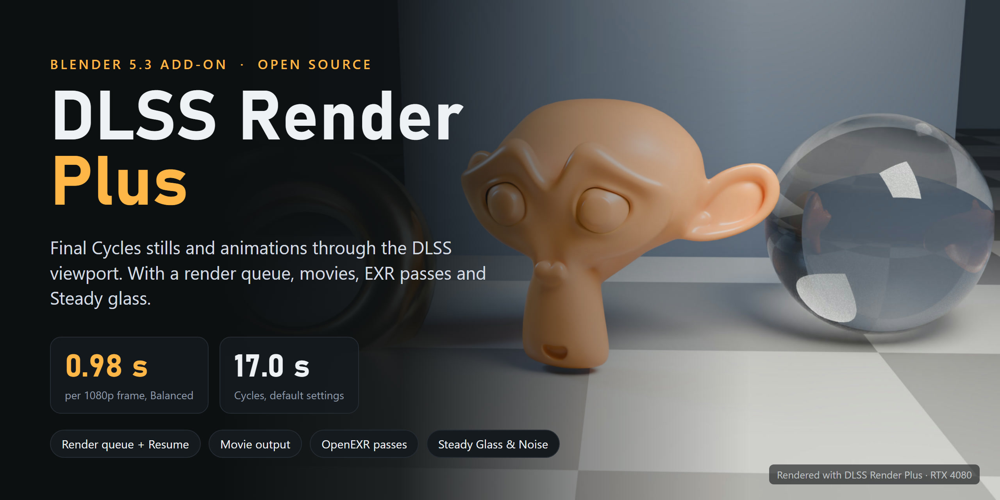
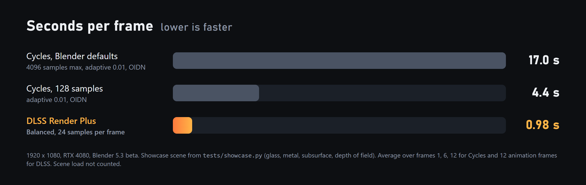
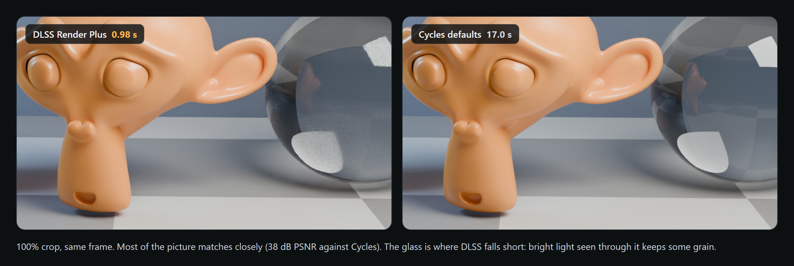
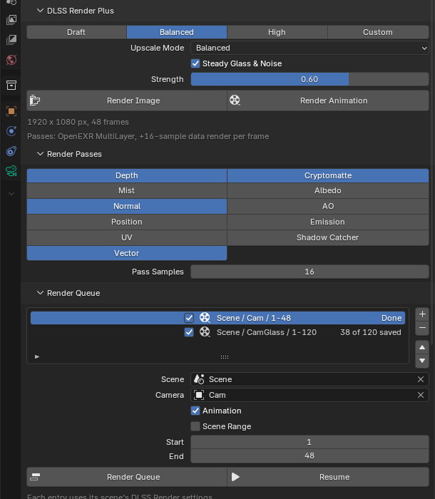
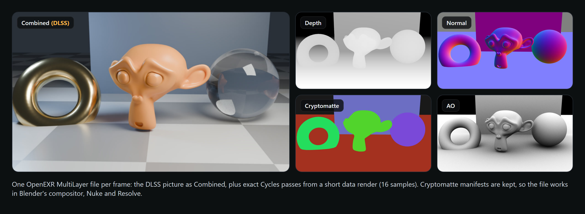
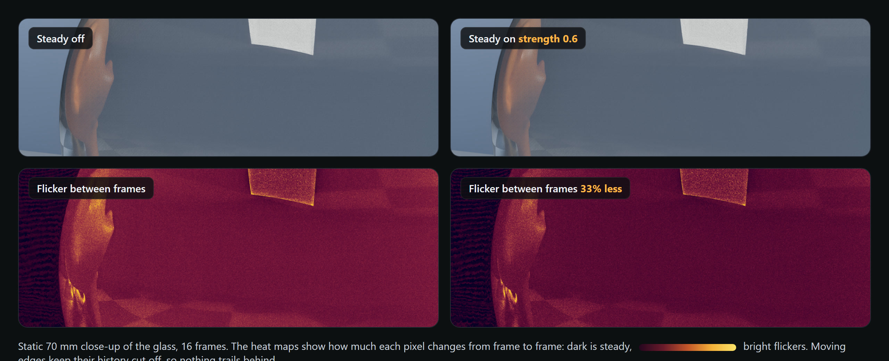

<p align="center">
  
</p>

<p align="center">
  
  
  
</p>

# DLSS Render Plus

Blender 5.3 can clean up the Cycles viewport with NVIDIA DLSS, but a final render (F12) can't use it. This add-on renders your final stills and animations through the DLSS viewport instead and saves them like a normal render: your resolution, frame range, output folder, file format and color management.

On my RTX 4080 a 1080p frame of the test scene takes 0.98 seconds. Cycles with Blender's default settings takes 17 seconds for the same frame.

It's a fork of the free version of [DLSS Render](https://armin5d.gumroad.com/l/dlss-render) by Armin5D, with a render queue, movie output, OpenEXR render passes and a flicker filter for glass added on top.

## Same name, different Armin

The original DLSS Render was made by Armin, who goes by [Armin5D](https://www.youtube.com/@armin5d) on YouTube and [Gumroad](https://armin5d.gumroad.com/l/dlss-render). My name is also Armin. We're not the same person and I'm not affiliated with him. I found his add-on, liked the idea, and built the extra features I wanted on top of his free GPL release.

The clever part, rendering final frames through the viewport and getting the pixels out cleanly, is his work. If this is useful to you, check out his add-on and his other stuff, and consider buying his Pro version to support him.

## Speed

<p align="center"></p>

That's 17x faster than Cycles at its defaults and about 4.5x faster than a light 128-sample render. Your numbers depend on the scene. The original author measured anywhere from under 2x on a glass-heavy interior to about 10x on a character close-up. Scenes with lots of glass gain the least.

<p align="center"></p>

Most of the frame is very close to the Cycles render. Glass is the weak spot: bright light seen through glass keeps some grain, because DLSS only gets a few new samples per picture. Higher quality settings help.

## Features

From the original free add-on:

- One panel in Render Properties, under Render Engine. If something is missing (Cycles, GPU compute, a camera), it says so and usually has a button that fixes it.
- Quality as samples per frame: Draft (8), Balanced (24), High (64) or a number of your own.
- Render Image and Render Animation buttons. Esc stops.
- Outputs bigger than your screen are rendered in overlapping tiles with blended seams, so 4K works on a 1080p monitor.
- Animations start a few frames early so DLSS has history from the first saved frame, and the viewport render restarts every 50 frames to avoid black frames.
- Viewport-only differences (hidden objects, modifiers off in the viewport, subdivision levels, particle amounts, Simplify) are switched to their render values during the render and put back afterwards.

Added in DLSS Render Plus:

- Render queue with Resume. Line up scenes, cameras and frame ranges. If Blender crashes or you press Esc, Resume renders only the missing frames.
- Movie output. Set the output to FFmpeg Video and you get the movie, made by ffmpeg from lossless 16-bit frames with the codec and quality you picked in Blender.
- Render passes. Depth, Normal, Position, UV, Vector, Cryptomatte, Albedo, AO, Emission, Mist and Shadow Catcher, saved with the DLSS picture in one OpenEXR MultiLayer file per frame.
- Steady Glass & Noise. A temporal filter that reduces frame-to-frame flicker on glass and fine detail.
- Camera cut handling. When a timeline marker switches cameras, or the camera jumps, the DLSS history is reset so the old shot doesn't ghost into the new one.
- A status bar line with the current frame, samples, percent done, time left and the clock time it'll finish. Windows is kept awake during the render, and you hear a chime when an animation or queue is done.

<p align="center"></p>

## Requirements

- Blender 5.3 or newer
- An NVIDIA RTX graphics card with a driver that runs DLSS in Blender's viewport (590 or newer)
- ffmpeg, only if you want movie output ([download](https://ffmpeg.org/download.html), or `winget install Gyan.FFmpeg` on Windows)

Some Blender 5.3 beta builds are missing NVIDIA's `nvngx_dlssd.dll`, so DLSS doesn't show up at all. [Troubleshooting](docs/troubleshooting.md#dlss-is-not-available-here) explains how to check and fix it.

## Install

1. Download `dlss_render_plus-<version>.zip` from [Releases](https://github.com/arminkhaleghirod/blender-dlss-render/releases). Don't unzip it.
2. If you have the original DLSS Render (Free or Pro) installed, disable it first under Edit > Preferences > Add-ons. Both drive the same viewport and can't render at the same time.
3. In Blender, go to Edit > Preferences > Get Extensions, open the arrow menu in the top right, choose Install from Disk, and pick the zip.
4. The DLSS Render Plus section is in Render Properties, right under Render Engine.

To build the zip yourself from this repo:

```bash
blender --command extension build --source-dir dlss_render_plus --output-dir dist
```

## Quick start

1. Set up your camera, resolution, frame range and output folder as usual.
2. Pick a quality. Balanced is a good start.
3. Click Render Image or Render Animation. The 3D Viewport goes full screen while it renders. Don't touch it until it's done, or press Esc to stop.

Before a long animation, render one frame and compare it with a normal F12 render. A few things only show up in final renders (see [limitations](#limitations)).

## Render passes

<p align="center"></p>

Open the Render Passes section and click the passes you want. Each frame then gets a short extra Cycles render (16 samples by default, adjustable) that only makes the data passes. They come from Cycles directly, so they're exact and line up with the picture. The file opens in Blender's compositor, Nuke or DaVinci Resolve, Cryptomatte included.

The extra render costs time on every frame, how much depends on the scene and the pass samples. Passes need an image output; they don't work with movie output.

## Steady Glass & Noise

<p align="center"></p>

On a static close-up of the glass, Steady cut the frame-to-frame flicker by 33% at the default strength of 0.6. It reduces flicker between frames, not the grain inside a single frame. Moving edges aren't blended with the previous frame, so it doesn't leave trails, and a camera cut resets it. It runs on the CPU and costs about 0.1 seconds per 1080p frame.

## Render queue

Open the Render Queue section and click + to add the current scene, camera and frame range. Each entry can have its own scene, camera and range, and uses that scene's DLSS settings (quality, passes, Steady, output). Render Queue starts everything from the beginning. Resume keeps what's already saved and renders the rest.

Progress is saved after every frame in `<your file>.dlss_queue.json` next to the .blend, so Resume also works after a crash.

## Limitations

- Bright light seen through glass stays a bit grainy. More samples help; Steady helps with flicker in animations.
- Only what the viewport shows gets rendered. Things that only exist in a final render (some particle instances, for example) can be missing. Check one frame first.
- No motion blur. Render the Vector pass and use a Vector Blur node if you need it.
- Don't render anything else on the same graphics card at the same time. DLSS gets fewer samples and you get more grain.
- While it renders, Blender's window is used for the render.
- Blender 5.3 has no RGBA option for ProRes, so ProRes output has no alpha. Use FFV1 or an image sequence if you need it.

## Documentation

- [How it works](docs/how-it-works.md): the viewport trick, DLSS history, tiling, passes, Steady and the queue in more detail
- [Troubleshooting](docs/troubleshooting.md): DLSS missing, black frames, ghosting, ffmpeg not found
- [Testing](docs/testing.md): the test suite and how the benchmark numbers above were made

## Credits and license

DLSS Render Plus is based on DLSS Render 1.0.2 by [Armin5D](https://armin5d.com), released under the GPL. This fork is also licensed under GPL-3.0-or-later; see [LICENSE](LICENSE).

DLSS Render Plus is an independent add-on. It isn't made or endorsed by NVIDIA, by the Blender Foundation, or by Armin5D. NVIDIA and DLSS are trademarks of NVIDIA Corporation. Blender is a trademark of the Blender Foundation.
